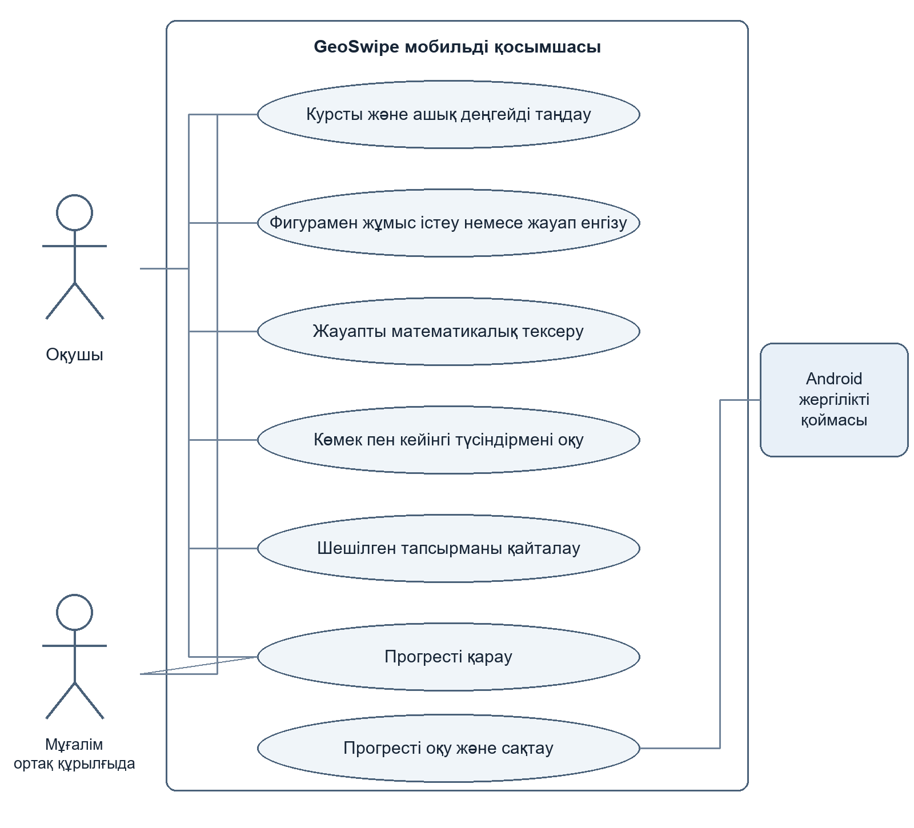
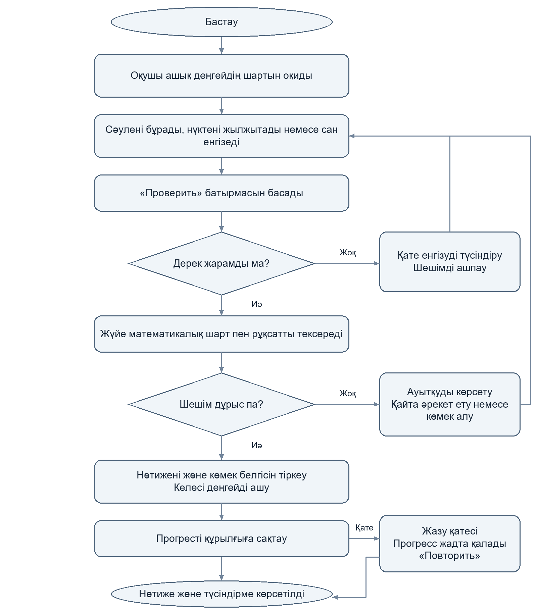
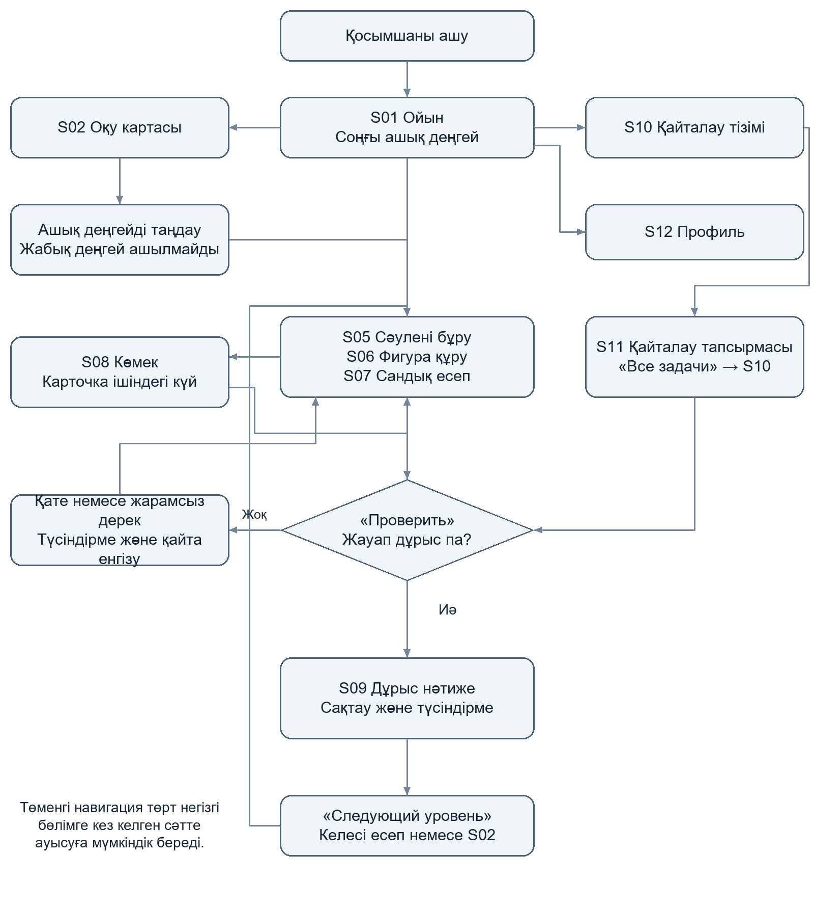
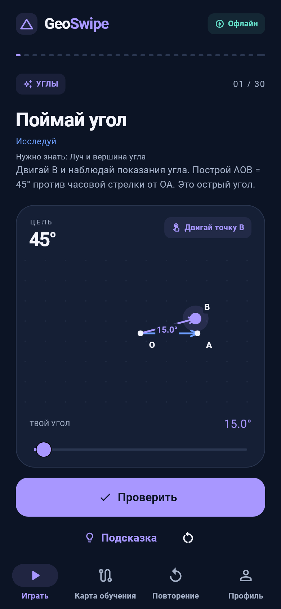
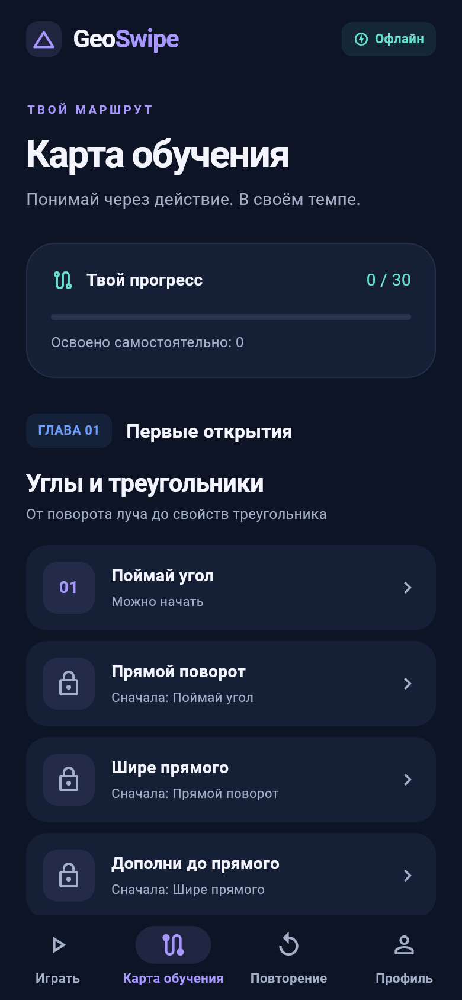
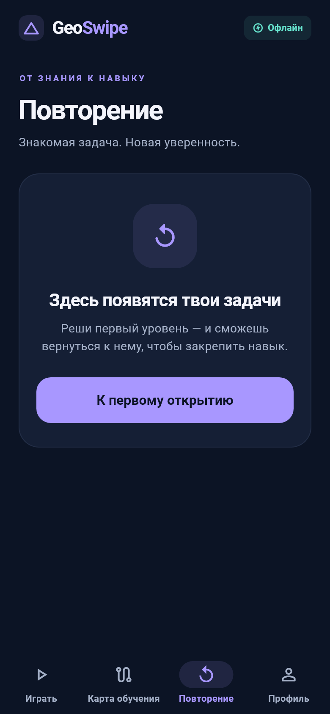
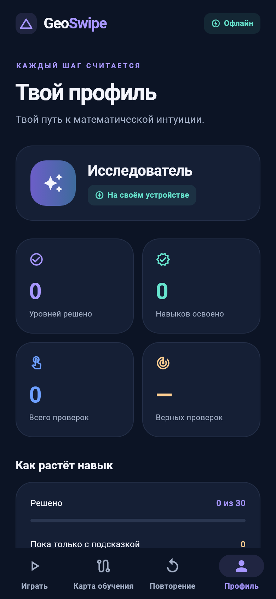

Оқу орны  ______________________________________________

Кафедра  _______________________________________________

Практикалық жұмыс 1

Мобильді қосымшаны жобалау және бастапқы Flutter нұсқасын сипаттау

Орындаған  _____________________________________________

Тобы  __________________________________________________

Тексерген  _____________________________________________

2026 жыл

---

# 1 Жобаның қысқаша сипаттамасы

GeoSwipe — геометрия мен тригонометрияны интерактивті есептер арқылы үйрететін, интернетсіз жұмыс істеуге бағытталған Flutter мобильді ойыны. Оқушы сәулені бұрады, фигураның нүктелерін жылжытады немесе сандық жауап енгізеді. Жүйе шешімді математикалық шарттармен тексеріп, нәтижені құрылғыда сақтайды.

| Көрсеткіш | Сипаттамасы |
| --- | --- |

| Жоба атауы | GeoSwipe |

| Саласы | Білім беру технологиялары, математика және мобильді ойындар |

| Негізгі платформа | Android; веб нұсқа әзірлеу мен көрсетуге арналған |

| Технология | Flutter 3.44.6, Dart 3.12.2, Material 3 |

| Интерфейс тілі | Қолданыстағы нұсқада орыс тілі; осы есеп қазақ тілінде |

| Деректер | Құрылғыдағы SharedPreferencesAsync, JSON; аккаунт қажет емес |

| Мазмұны | 30 деңгей: бұрыштар мен үшбұрыштар, Пифагор және ұзындықтар, тригонометрия |

| Бастапқы код | github.com/bekw-eg/GeoSwipe; тексерілген негіз — main, ce561e6 |

## Құжаттың мақсаты мен қамтуы

Бұл құжат практикалық жұмыстың 18 тапсырмасын GeoSwipe жобасына қолданады: пәндік талдау, пайдаланушылар, талаптар, сценарийлер, диаграммалар, экрандар, Flutter құрылымы және тестілеу. Бастапқы нұсқада төрт негізгі бөлім бар: «Играть», «Карта обучения», «Повторение», «Профиль». Жеке бетке шығарылуы жоспарланған көріністер 10 бөлімде көрсетілген.

Қосымшаның ерекшелігі — қысқа есептерді қимыл арқылы орындау, жауапты координатаның дәл түсуімен емес, математикалық қасиеттермен тексеру және көмекпен шешуді өз бетінше меңгеруден бөлек есепке алу.

## Құжаттағы бөлімдер

1–4: жоба, талдау, мақсат, аудитория. 5–7: функционалдық және функционалдық емес талаптар, User Story. 8–9: акторлар, Use Case және бизнес-процесс. 10–11: экрандар мен User Flow. 12–16: Flutter құрылымы, интерфейс, тест нәтижелері, қорытынды және дереккөздер.

---

# 2 Пәндік саланы талдау

Геометрияда сызбаны оқу, бұрыш пен ұзындықтың байланысын түсіну және формуланы дұрыс қолдану қатар қажет. Қағаздағы есеп пен динамикалық сызба әртүрлі оқу әрекетін қолдайды. GeoSwipe қысқа жаттығуда оқушының әрекетіне бірден кері байланыс беруді көздейді. Төмендегі мәселелер жобалық талдау ретінде берілген; пайдаланушылармен сауалнама жүргізілгені туралы дерек жоқ.

| Мәселе | Оқушыға әсері | GeoSwipe шешімі |
| --- | --- | --- |

| Статикалық сызба | Нүкте жылжығанда қасиеттің қалай өзгеретінін байқау қиын. | Сәулені бұру және нүктелерді жылжыту. |

| Тексерудің кешігуі | Қате әрекет бірнеше есеп бойы қайталануы мүмкін. | «Проверить» арқылы жедел математикалық кері байланыс. |

| Интернетке тәуелді оқу | Байланыс жоқ жерде жаттығу үзіледі. | Контент, шрифт және прогресс құрылғыда. |

| Шешу мен меңгеруді шатастыру | Көмекпен алынған дұрыс жауап білімді асыра бағалатады. | Көмекпен, өз бетінше және қайталап шешу бөлек есептеледі. |

## Екі ұқсас мобильді қосымшаны салыстыру

| Қосымша | Мүмкіндігі мен артықшылығы | Осы жоба мақсатына қатысты шектеуі |
| --- | --- | --- |

| GeoGebra Geometry [1] | Бұрыш, шеңбер және түрлендірулерді құруға арналған еркін геометриялық орта; мобильді қолданбалары бар. | Еркін құралдар ортасында қысқа жаттығу ретін және тапсырма шартын мұғалім не оқушы өзі ұйымдастырады. |

| Euclidea [2–3] | Сызғыш пен циркульге негізделген есептер, автоматты тексеру, көмек және динамикалық сызба. | Негізгі екпін геометриялық салуларға түседі; ең аз әрекет пен жұлдыз арқылы өту бастаушыға қосымша талап қояды. |

GeoGebra мүмкіндіктері [1], Euclidea механикасы мен өту шарттары [2–3] ресми дереккөздерден қаралды. Салыстырудағы шектеулер — осы оқу жобасының мақсатына қатысты талдау; қосымшалардың жалпы сапасына баға емес.

## Негізгі мәселе

7–11 сынып оқушысына геометриялық қасиетті өз әрекеті арқылы байқап, қателігін сол сәтте түсініп, интернетсіз жаттығуға болатын қарапайым орта қажет. GeoSwipe бұл мәселені басқарылатын сызба, деңгейлік есеп, тексеру және жергілікті прогресс арқылы шешеді.

---

# 3 Жобаның мақсаты мен міндеттері

## Негізгі мақсат

Android құрылғысында интернетсіз орындалатын интерактивті есептер арқылы геометрия мен тригонометрияны түсінуге және өз бетінше жаттығуға мүмкіндік беретін GeoSwipe қосымшасын әзірлеу.

## Мақсатқа жету міндеттері

1. Оқушының сызбамен жұмыс істеу және жедел кері байланыс алу қажеттіліктерін анықтау.

2. Бұрыштар, Пифагор теоремасы және тригонометрия тақырыптары бойынша есептер каталогын ұйымдастыру.

3. Математикалық есептеулер мен жауапты тексеруді интерфейстен бөлу.

4. Сәулені бұру, нүктені жылжыту және сандық жауап енгізу механизмдерін жасау.

5. Қате жауап, көмек және дұрыс шешімнен кейінгі түсіндірме логикасын енгізу.

6. Келесі деңгейдің ашылуын, қайталау мен меңгеру мәртебелерін анықтау.

7. Прогресті жергілікті сақтау және жазу қатесінде деректі қорғау.

8. Экрандарға бейімделетін интерфейсті, навигацияны және автоматты тексерулерді ұйымдастыру.

## Бірінші нұсқаның мүмкіндіктері

MVP құрамына төрт негізгі бөлім, үш тақырыптағы 30 деңгей, үш жауап механикасы, математикалық тексеру, кезектесіп ашылатын көмек, сәтті жауаптан кейінгі түсіндірме, қайта бастау, қайталау, профиль және жергілікті сақтау кіреді. Тіркелу, сервер, төлем, жарнама және бұлттық синхрондау талап етілмейді.

## Күтілетін нәтиже және қабылдау шарттары

Оқушы алғашқы деңгейді ашып, фигураны өзгерте алады; дұрыс жауап келесі деңгейді ашады; қате жауап тапсырманы жабады деп есептелмейді. Қайта іске қосқанда сақталған статистика қалпына келеді. Бастапқы интерфейс кемінде екі бөлім арасында ауысуды қолдайды; қолданыстағы жобада төрт бөлім бар.

Шешілген тапсырма, көмекпен шешілген тапсырма және меңгерілген дағды бөлек сақталады. Тексерілген main нұсқасында меңгеру үшін кемінде екі дербес сәтті шешім, соның ішінде жаңа қайталау әрекеті қажет. Бұл ереже ұзақ мерзімді білімнің ғылыми өлшемі ретінде қарастырылмайды.

---

# 4 Мақсатты аудитория және пайдаланушы бейіндері

| Топ | Мақсаты мен қажеттілігі |
| --- | --- |

| 7–9 сынып оқушысы | Бұрыштар мен үшбұрыштарды көру, әрекетпен түсіну, қателікті түзету. |

| 10–11 сынып оқушысы | Тригонометрия мен ұзындық есептерін қысқа жаттығулар арқылы бекіту. |

| Математика мұғалімі | Өз құрылғысында сызбаны көрсету, оқушының ойлау жолын талқылау. |

| Ата-ана | Баламен бірге жаттығу, баланың келісімімен сол құрылғыдағы прогресті қарау. |

Төмендегі төрт Persona — жобалау үшін құрастырылған ойдан алынған бейіндер. Қосымшада мұғалімге немесе ата-анаға арналған қашықтан басқару кабинеті жоқ.

## Persona 1 Айдана Серікқызы

| Ақпарат | Сипаттамасы |
| --- | --- |

| Жасы және қызметі | 13 жас, 7 сынып оқушысы |

| Мақсаты | Бұрыш түрлерін және градус өлшемін түсіну. |

| Қажеттілігі | Сәулені жылжыту, бұрыштың өзгерісін көру, түсінікті көмек. |

| Мәселелері | Формуланы жаттайды, бірақ сызбадағы мағынасын ажыратуға қиналады. |

| Күтетін нәтижесі | 45° пен 90° бұрышты құрып, қателігін өзі түзете алу. |

## Persona 2 Данияр Мұратұлы

| Ақпарат | Сипаттамасы |
| --- | --- |

| Жасы және қызметі | 17 жас, 11 сынып оқушысы |

| Мақсаты | Пифагор теоремасы мен тригонометриялық қатынастарды бекіту. |

| Қажеттілігі | Қысқа сандық есептер, үтірмен жауап енгізу, қайталау, нақты статистика. |

| Мәселелері | Жолда интернет тұрақсыз; дайын жауапты көру білімін бағалауға кедергі. |

| Күтетін нәтижесі | Өз бетінше дұрыс шешетін тақырыптарын анықтап, әлсіз тұсын қайталау. |

---

# 4 Пайдаланушы бейіндерінің жалғасы

## Persona 3 Әлия Нұрланқызы

| Ақпарат | Сипаттамасы |
| --- | --- |

| Жасы және қызметі | 34 жас, математика мұғалімі |

| Мақсаты | Оқушыға геометриялық байланысты қозғалмалы сызба арқылы көрсету. |

| Қажеттілігі | Тақырып картасы, математикалық дұрыс шектеулер, бір есепке қайта оралу. |

| Мәселелері | Статикалық суреттен нүкте қозғалысының әсерін түсіндіру көп уақыт алады. |

| Күтетін нәтижесі | Сабақта бір құрылғы арқылы есепті талқылап, балама дұрыс салуларды қабылдату. |

## Persona 4 Ерлан Асқарұлы

| Ақпарат | Сипаттамасы |
| --- | --- |

| Жасы және қызметі | 41 жас, ата-ана, инженер |

| Мақсаты | Баласының үйдегі математикалық жаттығуына көмектесу. |

| Қажеттілігі | Аккаунтсыз жұмыс, баламен бірге профильді қарау, түсіндірмелер. |

| Мәселелері | Көмекпен орындалған есепті баланың толық меңгеруімен шатастыруы мүмкін. |

| Күтетін нәтижесі | Бала келісімімен оның құрылғысында дербес және көмекпен орындалған нәтижелерді ажырату. |

## Қажеттіліктерді жобалық шешімдермен байланыстыру

Айданаға арналған негізгі шешім — FR-04 және FR-05 интерактивті сызбалары. Данияр үшін FR-06 сандық енгізу және FR-12 қайталау қажет. Әлия FR-02 оқу картасын және FR-07 математикалық тексеруді пайдаланады. Ерлан FR-13 профильден баланың өз бетінше және көмекпен орындаған нәтижесін көреді.

Бір құрылғыдағы прогресс жеке жергілікті профильге тиесілі. Бірнеше адамның бөлек аккаунты, ата-ана бақылауы, мұғалімге автоматты есеп жіберу және мектеп журналымен біріктіру бірінші нұсқаға кірмейді.

---

# 5 Функционалдық талаптар

Барлық талап негізгі нұсқаға арналған. FR нөмірлері User Story, экрандар және тексеру сценарийлерімен байланыстырылады. S коды 10 бөлімдегі экранды немесе жобалық көріністі білдіреді.

| ID | Әрекет | Күтілетін нәтиже |
| --- | --- | --- |

| FR-01 | Қосымшаны интернетсіз ашу және сақталған деңгейді жүктеу. | Соңғы қолжетімді тапсырма ашылады; алғаш кіргенде бірінші деңгей көрсетіледі. S01. |

| FR-02 | Үш тақырып пен 30 деңгейдің оқу картасын көрсету. | Тақырыптар, реттік нөмірлер және шынайы прогресс көрінеді. S02. |

| FR-03 | Деңгейді алғышартқа сай ашу. | Бастапқыда бірінші есеп қолжетімді; дұрыс шешім келесісін ашады; жабық деңгейге өтуге болмайды. S02. |

| FR-04 | Сәулені маркермен не жүгірткімен бұру. | Бұрыш мәні жаңарады; нөлдік вектор бағытын бұзбайды. S05. |

| FR-05 | Фигура нүктелерін жылжыту. | Сызба өзгереді; жарамды балама, оның ішінде айнадағы шешім қабылданады. S06. |

| FR-06 | Сандық жауапты үтірмен немесе нүктемен енгізу. | Қалыпты сан талданады; бос жол, NaN және шексіздік шешім ретінде қабылданбайды. S07. |

| FR-07 | «Проверить» арқылы шартты тексеру. | Бұрыш, ұзындық не қатынасқа қойылған рұқсатпен дұрыс немесе қате нәтиже беріледі. S05–S09. |

| FR-08 | Қате туралы түсінікті кері байланыс беру. | Ауытқу не енгізу қатесі көрсетіледі; оқушы түзетіп қайта тексере алады. S05–S07. |

---

# 5 Функционалдық талаптардың жалғасы

| ID | Әрекет | Күтілетін нәтиже |
| --- | --- | --- |

| FR-09 | Көмекті кезекпен ашу және оны есепке алу. | Көмек қолданылғаны белгіленеді; ағымдағы есептің толық шешімі алдын ала көрсетілмейді. S08. |

| FR-10 | Дұрыс жауаптан кейін түсіндірме мен келесі әрекетті көрсету. | Түсіндірме ашылады; бір аяқталған әрекет қайта басумен екі рет саналмайды. S09. |

| FR-11 | Тапсырманы жаңа әрекет ретінде қайта бастау. | Фигура не енгізу күйі қалпына келеді; бұрынғы статистика жойылмайды. S05–S07. |

| FR-12 | Шешілген есепті бөлек қайталау. | Тізімнен не «Начать повторение» арқылы жаңа әрекет ашылады; «Все задачи» тізімге қайтарады. S10–S11. |

| FR-13 | Профильде шынайы статистиканы көрсету. | Шешілген, көмекпен шешілген, меңгерілген деңгейлер және тексерулер саны көрінеді. S12. |

| FR-14 | Аяқталған прогресті құрылғыда сақтау және қайта оқу. | Нәтиже мен соңғы деңгей қалпына келеді; аяқталмаған фигура мен енгізу қалпына келмейді. S01, S12. |

| FR-15 | Сақтау не оқу қатесін өңдеу. | Ескерту мен «Повторить» беріледі; бүлінген сақтау үнсіз қайта жазылмайды. S01. |

| FR-16 | Төрт негізгі бөлім арасында ауысу. | Төменгі навигация дұрыс бөлімді ашады; картадан таңдалған есеп ойын бөліміне өтеді. S01, S02, S10, S12. |

## Математикалық тексеру ережелері

Алғашқы бұрыш есептерінде 45° нысанасы үшін 43°–47° қоса қабылданады; негізгі рұқсат ±2°, техникалық epsilon 10⁻⁹°. Құрама салуларда шартқа қарай бұрыш ±1°, тең қабырғалардың айырмасы 0,05-ке дейін, қатынас ±0,01 болуы мүмкін. Әр есеп өз рұқсатын көрсетеді.

Бүтін жауап дәл тексеріледі. Жүздікке дейін дөңгелектелетін жауап үшін абсолют рұқсат ±0,005. Бір түзудегі үш нүктеден құралған фигура, нөлдік кесінді және анықталмаған тригонометриялық қатынас дұрыс шешім ретінде қабылданбайды.

---

# 6 Функционалдық емес талаптар

Бұл бөлім тексерілетін қабылдау шарттарын белгілейді. Өнімділікке арналған уақыт межелері мақсат болып саналады; құрылғыда өлшенген көрсеткіш ретінде ұсынылмайды.

| ID және бағыт | Талап және тексеру тәсілі |
| --- | --- |

| NFR-01 Қауіпсіздік | Қолданба аккаунт, құпиясөз не жеке байланыс деректерін сұрамауы тиіс. Орнатылған APK-ны ұшақ режимінде ашып, оқу, тексеру және сақтау әрекеттерін орындау; желілік қызметке тәуелділік болмауы керек. |

| NFR-02 Өнімділік | Android сынақ құрылғысында бастапқы экран 3 секунд ішінде, жауапты тексеру 300 мс ішінде көрінуі тиіс. 20 қайталау бойынша өлшеу; құрылғы моделі мен құрастыру түрін хаттамаға жазу. |

| NFR-03 Сенімділік | Тізбекті сақтау нәтижені жоғалтпауы тиіс. Жазу қатесін еліктетіп, прогрестің жадта қалуын, қайта жазуды және бүлінген JSON-ның сақталуын тестпен тексеру. |

| NFR-04 Қолайлылық | Негізгі экраннан тапсырманы тексеру әрекетіне үштен көп емес мағыналы қадаммен жету. Қате хабарламасы түзетуге болатын әрекетті түсіндіруі тиіс. |

| NFR-05 Бейімделу | 320×568 және көлденең 844×390 логикалық пиксельде негізгі басқарулар қолжетімді; қажет болса карточка айналдырылады. Widget тестінде overflow болмауы тиіс. |

| NFR-06 Бірізділік | Төрт бөлім бір ThemeData, түс палитрасы және ортақ карточка/батырма компоненттерін қолдануы тиіс. Негізгі атаулар мен навигация барлық бөлімде бірдей. |

| NFR-07 Қолжетімділік | Мәтін масштабы 1,8 болғанда мазмұн қиылмауы тиіс. Негізгі әрекет батырмасының нысанасы кемінде 48×48 логикалық пиксель; бұрышты жүгірткімен де өзгерту мүмкін. |

| NFR-08 Қызмет көрсету | Математика core/geometry ішінде Flutter-ге тәуелсіз болуы тиіс; widget тек көрсету мен әрекетке жауап береді. flutter analyze қатесіз, тиісті unit тесттері сәтті өтуі қажет. |

| NFR-09 Дәлдік | Математикалық рұқсат шекарасы, айнадағы шешім, NaN және нөлдік өлшемдер unit тестпен тексеріледі. Жауап экран пикселінің дәлдігіне тәуелді болмауы тиіс. |

| NFR-10 Деректер үйлесімі | Сақтау нұсқасы тексеріледі. Танылмаған нұсқа автоматты жойылмайды; болашақ схема өзгерісіне айқын миграция қажет. Қайта іске қосу тесті жинақталған есептегіштерді сақтауы тиіс. |

---

# 7 User Story және қабылдау критерийлері

## US-01 Интернетсіз оқу

Оқушы ретінде мен интернетсіз есеп ашқым келеді, себебі кез келген жерде жаттығуым керек.

Рөлі: Оқушы. Байланысты талаптар: FR-01, FR-14.

ҚК 1. Android қосымшасы алғашқы орнатудан кейін желісіз негізгі тапсырманы жүктейді.

ҚК 2. Жауапты тексеру желілік қатесіз орындалады; прогресс сол құрылғыда сақталады.

## US-02 Тақырып пен деңгейді таңдау

Оқушы ретінде мен оқу картасынан деңгейді таңдағым келеді, себебі қай тақырыпты өту керегін білгім келеді.

Рөлі: Оқушы. Байланысты талаптар: FR-02, FR-03, FR-16.

ҚК 1. Картада үш тақырып пен деңгейлердің реті көрсетіледі.

ҚК 2. Ашық деңгейді басқанда сәйкес есеп ашылады; жабық деңгейге өту тоқтатылады.

## US-03 Бұрышты әрекетпен түсіну

7 сынып оқушысы ретінде мен сәулені бұрып берілген бұрышты құрғым келеді, себебі градус өлшемінің мағынасын түсінгім келеді.

Рөлі: 7 сынып оқушысы. Байланысты талаптар: FR-04, FR-07.

ҚК 1. Маркерді жылжытқанда бұрыш өлшемі өзгереді; жүгірткі сол бұрышты басқарады.

ҚК 2. 45° есебінде 43° және 47° шекаралары қабылданады, рұқсаттан тыс бұрыш қабылданбайды.

## US-04 Баламалы салуды қабылдау

Мұғалім ретінде мен математикалық дұрыс әртүрлі салуларды тексергім келеді, себебі оқушы бір үлгіні көшірмей қасиетті түсінсін.

Рөлі: Мұғалім. Байланысты талаптар: FR-05, FR-07.

ҚК 1. Шартты қанағаттандыратын айнадағы фигура да дұрыс нәтиже береді.

ҚК 2. Бір түзудегі үш нүкте мен нөлдік ұзындық жарамды үшбұрыш ретінде қабылданбайды.

---

# 7 User Story жалғасы

## US-05 Сандық жауап енгізу

Жоғары сынып оқушысы ретінде мен жауапты үтірмен не нүктемен енгізгім келеді, себебі әдеттегі сан жазылымын қолданғым келеді.

Рөлі: Жоғары сынып оқушысы. Байланысты талаптар: FR-06, FR-08.

ҚК 1. Бірдей мән беретін 1,25 және 1.25 бірдей талданады.

ҚК 2. Бос не жарамсыз енгізу түсінікті хабарлама береді және есепті аяқтамайды.

## US-06 Қатені түзету

Оқушы ретінде мен қате жауаптан кейін қайта әрекет еткім келеді, себебі қатенің себебін түсініп өзім шешкім келеді.

Рөлі: Оқушы. Байланысты талаптар: FR-07, FR-08, FR-03.

ҚК 1. Қате тексеру әрекет ретінде саналады, бірақ деңгейді шешілді деп белгілемейді.

ҚК 2. Оқушы сол тапсырмада жауапты түзетіп тексере алады; келесі деңгей тек дұрыс жауаптан кейін ашылады.

## US-07 Көмекті саналы пайдалану

Оқушы ретінде мен көмекті біртіндеп ашқым келеді, себебі шешу жолын өзім табуға мүмкіндік қалсын.

Рөлі: Оқушы. Байланысты талаптар: FR-09, FR-10, FR-13.

ҚК 1. Бірінші басу алғашқы көмек мәтінін, келесі басу келесі бөлігін көрсетеді.

ҚК 2. Дұрыс жауапқа дейін толық түсіндірме жасырын; көмектен кейінгі сәтті шешім көмекпен орындалды деп саналады.

## US-08 Нәтижені көру

Оқушы ретінде мен дұрыс жауаптан кейін түсіндірмені оқығым келеді, себебі қолданылған математикалық байланысты түсінгім келеді.

Рөлі: Оқушы. Байланысты талаптар: FR-10, FR-03.

ҚК 1. Түсіндірме тек сәтті тексеруден кейін ашылады.

ҚК 2. Аяқталған тапсырмадағы батырманы қайта басу сәттілікті екінші рет қоспайды; келесі есепке өтуге мүмкіндік береді.

---

# 7 User Story аяқталуы

## US-09 Есепті қайта орындау

Оқушы ретінде мен тапсырманы қайта бастап, қайталау бөлімінде шешкім келеді, себебі өз бетімше орындай алатынымды білгім келеді.

Рөлі: Оқушы. Байланысты талаптар: FR-11, FR-12.

ҚК 1. Қайта бастау жаңа фигура не бос жауап күйін береді және бұрынғы статистиканы өшірмейді.

ҚК 2. Қайталауда жаңа дербес шешім жеке есептеледі; «Все задачи» батырмасы қайталау тізіміне қайтарады.

## US-10 Прогресті түсіну

Ата-ана ретінде мен баламның келісімімен құрылғыдағы нәтижені қарағым келеді, себебі көмек пен дербес дағдыны ажыратқым келеді.

Рөлі: Ата-ана. Байланысты талаптар: FR-13.

ҚК 1. Профиль шешілген, көмекпен ғана шешілген және меңгерілген деңгейлерді бөлек көрсетеді.

ҚК 2. Бірде-бір әрекет жоқ болса, дұрыс жауап пайызы нөлдік статистика ретінде ойдан есептелмейді.

## US-11 Сақталған нәтижеге оралу

Оқушы ретінде мен қосымшаны қайта ашқанда прогресті жалғастырғым келеді, себебі аяқталған жұмысым жоғалмасын.

Рөлі: Оқушы. Байланысты талаптар: FR-01, FR-14.

ҚК 1. Сақтап қайта жүктегенде тексерулер саны, шешілген деңгей және соңғы қолжетімді деңгей қалпына келеді.

ҚК 2. Аяқталмаған сызба мен енгізілген сан сақталмайтыны түсінікті; аяқталған нәтиже өзгермейді.

## US-12 Сақтау қатесін өңдеу

Оқушы ретінде мен сақтау қатесін байқап, қайта сақтағым келеді, себебі нәтижемді қорғағым келеді.

Рөлі: Оқушы. Байланысты талаптар: FR-15.

ҚК 1. Жазу қатесінде ескерту және «Повторить» әрекеті көрсетіледі; статистика жадта қалады.

ҚК 2. Бүлінген файл не белгісіз нұсқа үнсіз алмастырылмайды; оқу қатесін қайта тексеруге болады.

---

# 8 Акторлар және Use Case диаграммасы

| Актор | Рөлі мен әрекеті |
| --- | --- |

| Оқушы | Деңгей таңдайды, фигураны өзгертеді, жауап тексереді, көмек алады, қайталайды және прогресін қарайды. |

| Мұғалім | Сол құрылғыда картаны және сызбаны көрсетеді, профильдегі нәтижені оқушымен талқылайды. Жеке кабинет жоқ. |

| Ата-ана | Баланың келісімімен сол құрылғыдағы профильді қарайды; техникалық рұқсаты оқушы интерфейсінен бөлек емес. |

| Android жергілікті қоймасы | Қолданба сұратқан JSON прогресін оқу және жазу қызметін атқарады; қашықтағы сервер емес. |

Сызық актордың әрекетке қатысуын білдіреді. Ата-ана профильді оқушы сияқты қарайтындықтан диаграммадағы негізгі пайдаланушы әрекетін бөліседі. Түпнұсқа: use-case.drawio; файл diagrams.net ортасында өңделеді.

---

# 9 Есепті шешу бизнес процесі

Басталуы: оқушы қолжетімді есепті ашты. Алғышарты: каталог жүктелген және деңгей ашық. Негізгі нәтиже: дұрыс жауап, аяқталу мәртебесі, келесі деңгейге рұқсат және жергілікті прогресс. Көмек қолданылса, нәтиже дербес шешімнен бөлек белгіленеді.

Жарамсыз енгізу түзетуге қайтарылады. Математикалық қате кезінде түсіндірме толық шешімді ашпайды. Жазу қатесі есептің жадтағы нәтижесін жоймайды; қайта сақтау қолжетімді. Жүктеу кезінде сақтау бүлінген болса, ескерту көрсетіліп, бастапқы дерек қайта жазылмайды. Түпнұсқа: business-process.drawio.

---

# 10 Экрандар тізімі

Жобалық құрылым 14 экранды қамтиды. MVP-де төрт негізгі бөлім іске асқан; есеп түрлері, көмек және нәтиже ортақ карточкада көрсетіледі. Кесте жеке экран ретінде жоспарланған беттерді қолданыстағы интерфейспен шатастырмайды.

| ID | Экран | Мақсаты мен негізгі элементтері | Қазіргі мәртебе |
| --- | --- | --- | --- |

| S01 | Басты ойын экраны | Жобаның атауы, қысқаша сипаттама, ағымдағы есеп, «Проверить», төрт бөлім навигациясы. | Бар, PlayScreen. |

| S02 | Оқу картасы | Үш тақырып, деңгейлердің мәртебесі, жабық/ашық есеп белгісі; ашық есеп → S05–S07. | Бар, LearningScreen. |

| S03 | Тақырыптың толық беті | Тақырып мақсаты, алғышарт, деңгейлер тізімі, «Бастау» → S04; кері → S02. | Жоспар; қазір тақырыптар S02 ішінде. |

| S04 | Деңгейге кіріспе | Мақсат, шарт, қажетті білім, «Орындау» → есеп түрі; кері → S03. | Жоспар; қазір шарт карточка ішінде. |

| S05 | Сәулені бұру тапсырмасы | Сызба, бұрыш көрсеткіші, маркер, жүгірткі, тексеру, көмек, қайта бастау. | Бар, S01 карточкасының түрі. |

| S06 | Фигура құру тапсырмасы | Үшбұрыш/кесінді, қозғалмалы нүктелер, математикалық шарт, тексеру. | Бар, S01 карточкасының түрі. |

| S07 | Сандық есеп | Белгілі шамалар, жасырын белгісіз, жауап өрісі, өлшем бірлігі, тексеру. | Бар, S01 карточкасының түрі. |

Бастапқы нұсқаға қойылған талап — басты экран, негізгі әрекет батырмасы, кемінде бір қосымша экран және жұмыс істейтін навигация. Бұл талап S01, S02, S10 және S12 бөлімдерімен орындалады.

---

# 10 Экрандар тізімінің жалғасы

| ID | Экран | Мақсаты мен негізгі элементтері | Қазіргі мәртебе |
| --- | --- | --- | --- |

| S08 | Көмек беті | Кезекті нұсқаулар, қолданылған көмек белгісі; жабу → ағымдағы есеп. | Мазмұны бар; жеке бет жоспарланған. |

| S09 | Нәтиже және түсіндірме | Дұрыс жауап мәртебесі, негіздеу, келесі деңгей не картаға өту. | Карточка ішіндегі күйі бар; жеке бет жоспарланған. |

| S10 | Қайталау тізімі | Шешілген есептер, меңгеру мәртебесі, «Начать повторение», бос күй. | Бар, ReviewScreen. |

| S11 | Қайталау тапсырмасы | Жаңа әрекет, тапсырма құралдары, тексеру, «Все задачи» → S10. | Бар, ReviewScreen ішкі көрінісі. |

| S12 | Профиль және статистика | Шешілген есеп, әрекет саны, дұрыс жауап үлесі, көмек және меңгеру. | Бар, ProfileScreen. |

| S13 | Параметрлер | Болашақта мәтін өлшемі мен жергілікті деректер туралы ақпарат; кері → S12. | Жоспар; қазір жүйелік мәтін масштабы қолданылады. |

| S14 | Көмек және қолданба туралы | Басқару ережелері, рұқсат түсіндірмесі, офлайн сақтау шектеулері; кері → S12. | Жоспар; қысқа ережелер қазір тапсырмада берілген. |

## Талаптар мен экрандардың сәйкестігі

FR-01 және FR-14 → S01; FR-02–FR-03 → S02; FR-04 → S05; FR-05 → S06; FR-06 → S07; FR-07–FR-08 → есеп карточкалары; FR-09 → S08; FR-10 → S09; FR-12 → S10–S11; FR-13 → S12; FR-15 → басты қабықтағы ескерту. Қосымша жоспарланған экрандар MVP функциясын талапсыз кеңейтпейді, тек болашақ навигацияны нақтылайды.

---

# 11 User Flow сызбасы

Сызба іске асқан негізгі жолды көрсетеді: қолданбаны ашу → қолжетімді деңгей → жауапты тексеру → нәтиже → келесі есеп. S05–S09 қазіргі нұсқада ортақ карточкадағы көріністер. Қате жауап түзетуге, көмек ағымдағы есепке, қайталау тапсырмасы тізімге қайтарады.

S03, S04, S13 және S14 — келесі интерфейс итерациясына арналған жеке беттер; олардың өтулері экрандар кестесінде сипатталған. Бастапқы іске қосуда S01 тікелей ашылады. Түпнұсқа: user-flow.drawio.

---

# 12 Flutter жобасының құрылымы

Жоба атауы — geoswipe, нұсқасы — 0.1.0+1. Бар бастапқы код жаңа бос жобаға ауыстырылмайды. Жобаның тексерілген құрылымы:

lib/
  main.dart                     іске қосу нүктесі
  app.dart                      MaterialApp және 4 бөлім навигациясы
  core/
    app_controller.dart         қолданба күйі және әрекеттер
    theme.dart                  түстер мен типография
    geometry/                   таза математикалық функциялар
  models/                       деңгей, әрекет, нәтиже, прогресс
  data/                         каталог, көрініс, сақтау репозиторийі
  features/
    play/                       ойын және ортақ есеп карточкасы
    learning/                   оқу картасы
    review/                     қайталау
    profile/                    статистика
  widgets/                      сызба және ортақ компоненттер
test/                           unit және widget тесттері
assets/fonts/                   жергілікті Roboto
android/                        Android құрастыру параметрлері

## Архитектура және сақтау

Widget → AppController → таза математикалық тексеру → ProgressRepository → ProgressStore. SharedPreferencesAsync geoswipe.progress кілтінде JSON сақтайды; осы main нұсқасының схемасы — 1. Деңгей ID тұрақты; белгісіз деңгей жазбалары сақталады. Аяқталмаған жауап пен фигура қалпына келмейді. Деректерді не қолданбаны жою прогресті жояды; бұлттық көшірме жоқ.

## Интерфейстің көркемдік параметрлері

Негізгі фон #0C1425, карточка #151F35, күлгін екпін #A897FF, көгілдір #6D9FFF, жалбыз #66E3CD, негізгі мәтін #F4F5FC. Қаріп — жергілікті Roboto; Material 3 түнгі тақырыбы. Контент ені 540 логикалық пиксельмен шектеледі; шағын экранда карточка айналдырылады.

## Жобаны дайындау және іске қосу

Құралдар: Flutter 3.44.6, Dart 3.12.2, Android SDK, JDK 17. Репозиторийде flutter pub get, кейін flutter run командасы орындалады. Құрылғыны тексеру: flutter devices. Жаңа бос жоба үшін flutter create geoswipe қолдануға болады, бірақ дайын репозиторийді қайта құру қажет емес.

---

# 13 Интерфейс скриншоттары

Көріністер осы main нұсқасының орындалған widget тесттерінен алынды. Бұл — шынайы Flutter виджеттерінің рендері; Android эмуляторынан түсірілген сурет емес. Базалық логикалық экран — 390×844, кескін масштабы — 2×.

4 сурет  S01 ойын экраны және S02 оқу картасы

Ойын карточкасында есептің шарты, қозғалмалы сәуле, бұрыш көрсеткіші және тексеру батырмасы бар. Карта үш тақырыпты, тапсырмалардың ретін және қолжетімділігін көрсетеді. Орысша жазулар жобаның қолданыстағы интерфейс тіліне сәйкес сақталды.

---

# 13 Қайталау және профиль көріністері

5 сурет  S10 қайталау бөлімінің бос күйі және S12 профиль

Алғашқы іске қосуда қайталау тізімі бос және бірінші есепке өту ұсынылады. Профиль орындалмаған деңгейлерді жетістік ретінде көрсетпейді. Шешілген есеп пайда болғаннан кейін қайталау механикасы қолжетімді болады.

## Бейімделуді тексеру

Widget тесттері ықшам 320×568 экранда, көлденең экранда және үлкейтілген мәтінде басқару элементтерінің қолжетімділігін тексереді. 30 есеп бойынша 320×568 және 360×800, мәтін масштабы 1,8 режимдері автоматты тексеруге енгізілген.

---

# 14 Тестілеу сценарийлері мен нәтижелері

Тексерілген негіз: main тармағының ce561e6 коммиті. Орындау күні: 19 қазан 2026 жыл. Unit және widget тесттері нақты іске қосылды; төмендегі нәтижелер сол орындалуға тиесілі.

| ID | Әрекет және күтілетін нәтиже | Нақты нәтиже |
| --- | --- | --- |

| T-01 | GeoSwipeApp іске қосу → алғашқы есеп және төрт бөлім ашылады. | Өтті. app_test.dart: all four screens work with honest initial states. |

| T-02 | Сәулені 45°-қа бұрып «Проверить» басу → есеп шешіледі, түсіндірме және қайталау ашылады. | Өтті. app_test.dart: dragging the actual ray checks a real answer and enables review. |

| T-03 | Қайталауды жабу және қайта бастау → тізімге қайтып, келесі меңгерілмеген есеп таңдалады. | Өтті, контроллер деңгейінде. progress_test.dart: review prioritizes completed levels not yet mastered. Android Back бөлек тексерілмеді. |

| T-04 | 30 есепті кезекпен орындау → шешім алдын ала көрінбейді, дұрыс жауап келесі есепті ашады. | Өтті. course_ui_test.dart: all 30 lessons hide solutions, accept answers and advance to the next task. |

| T-05 | Нәтижені сақтап, контроллерді қайта құру → прогресс пен соңғы деңгей қалпына келеді. | Өтті. progress_test.dart: round trip restores progress and last visited level after restart. |

| T-06 | Көмек қолдану → көмекпен орындалған нәтиже дербес меңгеруге қосылмайды. | Өтті. progress_test.dart және course_ui_test.dart. |

| T-07 | Шағын экран мен үлкен мәтінде барлық есепті ашу → overflow жоқ, тексеру батырмасы қолжетімді. | Өтті. course_ui_test.dart: every lesson keeps controls reachable on compact screens and large text. |

| Команда | Нәтиже |
| --- | --- |

| flutter pub get | Өтті, тәуелділіктер алынды. |

| flutter analyze | Өтті, No issues found. |

| flutter test --reporter expanded | Өтті, 145 тест. |

| flutter build apk --debug | Өтті, debug APK жиналды. |

| Dart пішімдеуі | Dart коды өзгертілген жоқ; осы құжат тапсырмасында қайта пішімдеу қолданылмайды. |

Android құрылғысы қосылмаған, ал flutter emulators қолжетімді AVD бейнесін таппады. Сондықтан құрылғыдағы flutter run, Android Back және ұшақ режимі тексерілмеді. Интерфейс widget рендерімен тексерілді.

---

# 15 Қорытынды

GeoSwipe үшін мобильді қосымшаға техникалық тапсырма әзірленді: пәндік мәселелер талданды, мақсат пен сегіз міндет анықталды, төрт Persona, 16 функционалдық және 10 функционалдық емес талап, 12 User Story және әрқайсысына кемінде екі қабылдау критерийі жазылды. Акторлар, Use Case, есеп шешу процесі және User Flow диаграммалары талаптармен байланыстырылды.

Жобалық экрандар саны — 14. Қолданыстағы Flutter нұсқасында төрт негізгі бөлім, 30 тапсырма, тексеру, көмек, қайталау, профиль және жергілікті сақтау бар. Бастапқы интерфейс пен навигация widget тесттерімен расталды. Өнімділік межелері, толық TalkBack аудиті және нақты Android құрылғысындағы қолмен тексеру жеке қабылдау кезеңінде орындалады.

## Одан әрі орындалатын жұмыс

Жоспарланған жеке экрандарды қажетіне қарай енгізу; нақты құрылғыда офлайн іске қосу мен жүйелік кері қайтуды тексеру; 3 секунд және 300 мс өнімділік межелерін өлшеу; болашақ сақтау схемасын өзгертер алдында миграцияны дайындау. Пайдаланушылармен сұхбат жобалық бейіндер мен қажеттіліктерді нақтылауға көмектеседі.

# 16 Пайдаланылған дереккөздер

[1] GeoGebra. Calculators and Apps. Геометрия құралдары және мобильді қолданбалар. https://www.geogebra.org/download?lang=en. Қаралған күні: 19.10.2026.

[2] Euclidea. Geometric Constructions Game with Straightedge and Compass. https://www.euclidea.xyz/en/. Қаралған күні: 19.10.2026.

[3] Euclidea FAQ. L/E әрекеттері, жұлдыздар және деңгейлерге өту шарттары. https://www.euclidea.xyz/faq. Қаралған күні: 19.10.2026.

[4] GeoSwipe бастапқы коды және README. https://github.com/bekw-eg/GeoSwipe/tree/ce561e6. Каталог, математика, сақтау және тесттер осы нұсқаға сәйкес сипатталды.

## Тапсыру материалдары

Негізгі материал — осы Word құжаты. Диаграммалардың өңделетін түпнұсқалары: use-case.drawio, business-process.drawio, user-flow.drawio. Flutter бастапқы коды репозиторийде орналасқан; интерфейс суреттері мен тест нәтижелері есепке енгізілген.
